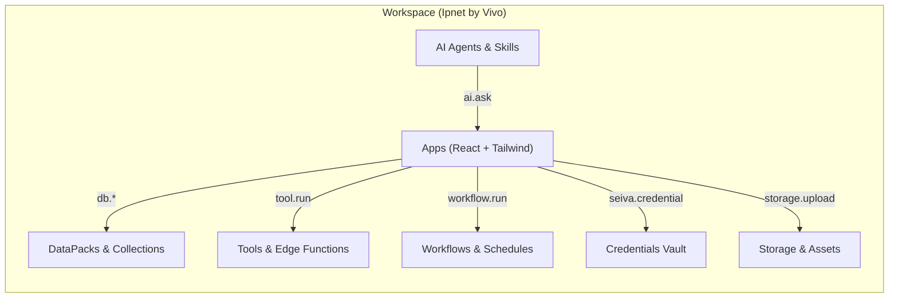

# CONTEXT.md — Guia de Arquitetura e Operação da Plataforma Vivo OS (Mogno AI)

Documento de referência técnica para desenvolvimento, manutenção e operação de aplicações e recursos no ecossistema **Vivo OS** (Mogno AI / Seiva).

---

## 1. Identificação do Workspace

- **Workspace:** `Ipnet by Vivo` (Slug: `ipnet-by-vivo`)
- **ID do Workspace:** `21bb24fc-c11d-44be-a6f9-6facc1ee6fac`
- **Ambiente Canônico:** `https://cloud.mogno.ai`
- **API Base:** `https://cloud.mogno.ai/api/v1/mgmt`
- **Usuário Conectado:** Nicollas Avila (`nicollas.avila@ipnet.cloud`)
- **Perfil de Acesso:** `admin` (escopo total de leitura, escrita, build e governança)

---

## 2. Arquitetura de Aplicações (Apps)

### Modelo de Execução
- **Client-Side Sandbox:** Os apps rodam em iframe isolado no navegador do usuário final.
- **Sem Backend Customizado:** Não existe Node.js, SSR (Server-Side Rendering) ou rotas de API Express locais nos apps.
- **Runtime Global:** A plataforma pré-injeta as configurações e o token de sessão via `window.__SEIVA_CONFIG__` e wrappers tipados disponíveis em `lib/seiva.ts`.

### Camada de Dados (Data Layer)
- **Persistência CRUD Padrão:** Utilizar os helpers `db.*` (`db.create`, `db.list`, `db.get`, `db.update`, `db.remove`) exportados por `lib/seiva`.
- **Consultas Avançadas:** `seiva.data.query`, `seiva.data.count` e `seiva.data.aggregate`.
- **DataPacks:** Coleções e tabelas externas ou compartilhadas são consumidas via `seiva.datapack(pack).table(name)` mediante concessão prévia de acesso (`grant`).
- **Nenhum Acesso Direto a Bancos:** Proibido o uso de drivers SQL (`pg`, `mysql`, `sqlite`) ou ORMs (`prisma`, `drizzle`, `typeorm`).

### Autenticação e Usuários
- **Zero Auth Code:** O usuário já está autenticado pela plataforma ao abrir o app. Proibido criar telas de login, cadastro, troca de senha, JWTs ou armazenamento de tokens no `localStorage`.
- **Contexto do Usuário:**
  - `users.currentUser()`: Retorna sincronamente o usuário atual (`id`, `name`, `email`).
  - `users.list()`: Lista membros do workspace para atribuição de tarefas e menções.
  - `users.me()`: Retorna metadados do app e escopo de permissão (`data_scope`).

---

## 3. Guardrails e Restrições Rígidas (Hard Constraints)

### Lista Fechada de Bibliotecas Permitidas (NPM Bundled)
Qualquer import fora da lista abaixo resultará em falha no build do esbuild:

| Categoria | Pacotes Permitidos |
| :--- | :--- |
| **Core** | `react`, `react-dom` |
| **UI & Ícones** | `@heroicons/react` |
| **Gráficos** | `echarts`, `echarts-for-react` *(ECharts é o padrão; amCharts 5 é restrito a apps legados)* |
| **Formulários** | `react-hook-form`, `@hookform/resolvers`, `zod` |
| **Tabelas** | `@tanstack/react-table` |
| **Diagramas / Fluxos** | `reactflow` |
| **Drag & Drop** | `@dnd-kit/core`, `@dnd-kit/sortable`, `@dnd-kit/utilities` |
| **Assinatura** | `react-signature-canvas` |
| **Calendário** | `@fullcalendar/core`, `@fullcalendar/daygrid`, `@fullcalendar/timegrid`, `@fullcalendar/interaction`, `@fullcalendar/list` |
| **Documentos & Planilhas** | `@react-pdf/renderer`, `docx`, `@tiptap/react`, `@tiptap/starter-kit`, `@tiptap/extension-*`, `@univerjs/presets`, `@univerjs/preset-sheets-core` |

### Dependências Externas e Redes
- **Host Approval Obrigatório:** Requisições para APIs externas ou scripts de CDN devem ser registradas previamente com a ferramenta `seiva_request_external_dependency` (`kind: "script"` ou `kind: "connect"`).
- **Sem WebSockets externos:** Apenas conexões HTTP/HTTPS autorizadas.
- **Segurança de Segredos:** Nenhuma credencial/chave de API deve ser injetada no código. Utilizar o cofre da plataforma via `seiva.credential("NOME_DO_SEGREDO")`.

---

## 4. Recursos da Plataforma

- **Apps:** Interfaces visuais interativas (telas, formulários, painéis operacionais).
- **Tools & Edge Functions:** Lógicas computacionais isoladas disparadas sob demanda (`tool.run(nome, input)`).
- **Workflows:** Grafos sequenciais e paralelos de execução assíncrona com suporte a aprovação humana (HITL).
- **Agents:** Agentes de IA customizados com prompts estruturados e conjuntos de ferramentas vinculadas.
- **Context Blocks:** Blocos de conhecimento e contexto institucional injetados dinamicamente nos agentes.

---

## 5. Protocolo de Operação para Agentes e Desenvolvedores

1. **Investigação Prévia:**
   - Obter o contexto do app com `seiva_get_project_context` antes de alterar código.
   - Listar arquivos com `seiva_list_files` e ler arquivos pontuais com `seiva_read_file`.
2. **Controle de Concorrência (EditLock):**
   - Antes de editar arquivos em sessões multi-agente, adquirir o lock via `seiva_app_lock` (`action: "acquire"`).
3. **Ciclo de Edição e Validação:**
   - Aplicar alterações de arquivos via `seiva_write_file` ou `seiva_edit_file_diff`.
   - Executar compilação com `seiva_build_app`. Em caso de erro 422, seguir as orientações do `classifier.agent_prompt`.
   - Testar o comportamento com `seiva_test_app`.
   - Publicar a versão estável com `seiva_publish_app`.

---

## 6. Ferramentas do Projeto Local

- `src/client.js`: Cliente HTTP encapsulando as chamadas para a API de Gestão (`/api/v1/mgmt`) autenticadas pela chave do `.env`.
- `src/status.js`: Script de diagnóstico rápido de integridade da conexão (`npm run status`).
- `.mcp.json`: Configuração do servidor MCP local para integração direta com ferramentas de agentes.

