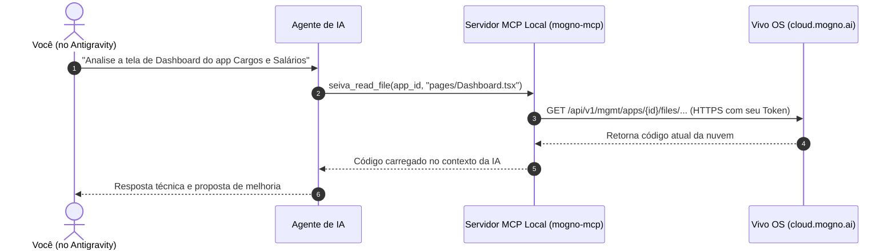

# 🚀 Guia Prático: Antigravity IDE + Vivo OS (Mogno AI)

Ambiente integrado para desenvolver, auditar e operar aplicações do **Vivo OS** diretamente da sua IDE favorita via inteligência artificial e **MCP (Model Context Protocol)**.

---

## 💡 O que é isso e por que usar?

Em vez de programar apenas pelo chat web no navegador (copiando arquivos manualmente entre apps e sem visão integrada do código), agora o time consegue operar o **Vivo OS diretamente do Antigravity (ou VS Code/Cursor)**:

1. **Visão Multi-App:** A IA lê o código de qualquer app do nosso workspace para análise, documentação ou engenharia reversa.
2. **Edição 100% Remota:** Alterações são enviadas via API REST oficial da plataforma em tempo real (sem precisar clonar código localmente).
3. **Replicação Rápida de Módulos:** Copie e adapte módulos complexos de um app para outro (ex: *IAM/Organograma*, *fluxos de aprovação*, *leitura de PDFs/OCR*, *integrações com ERP Sankhya*) com uma simples instrução para o assistente.
4. **Build & Preview Imediatos:** Dispare compilação na nuvem e receba a URL de preview para validar visualmente antes de publicar.

---

## 🛠️ Como Funciona por Baixo dos Panos?



- **MCP (Model Context Protocol):** Protocolo local que dá "ferramentas" à IA na sua máquina.
- **API REST (cloud.mogno.ai):** Cada ferramenta dispara chamadas oficiais para a nuvem da Vivo OS usando a sua credencial pessoal.

---

## ⚡ Passo a Passo de Instalação (Setup em 2 Minutos)

### Pré-requisitos
- [Node.js](https://nodejs.org/) instalado (versão 18 ou superior).
- [Antigravity IDE](https://antigravity.google/) (ou VS Code com suporte a MCP).
- Sua chave pessoal de API gerada na plataforma:
  👉 Acesse **https://cloud.mogno.ai/api-keys**, clique em **Nova Chave**, nomeie (ex: `antigravity_seu_nome`), selecione o escopo **Workspace** com acesso **Full**.

---

### Passo 1: Clonar o repositório do time
Abra o terminal e execute:
```bash
git clone https://github.com/NicollasAvila/vivo-os-antigravity.git
cd vivo-os-antigravity
```

### Passo 2: Instalar as dependências
```bash
npm install
```

### Passo 3: Rodar o assistente interativo de configuração
```bash
npm run setup
```
> O assistente solicitará a sua chave (`seiva_...`), validará seu acesso no workspace, criará seu `.env` local e registrará o servidor MCP automaticamente no seu Antigravity IDE.

### Passo 4: Validar a conexão
```bash
npm run status
```
Se tudo estiver correto, você verá no terminal seu nome, cargo no workspace e a lista dos 22 apps acessíveis.

---

## 🎯 O que dá pra fazer na prática? (Exemplos de Prompts)

Com o Antigravity aberto nesta pasta, você pode pedir para a IA interagir diretamente com a plataforma:

### 1. Inspecionar e Auditar um App
> *"Inspecione o app Cargos e Salários (`a3814723-98d0-40b6-89b4-f85559116cef`), leia o arquivo `pages/Dashboard.tsx` e me explique como os filtros de área e cargo funcionam."*

### 2. Corrigir um Bug ou Fazer uma Alteração
> *"No app Cargos e Salários, adicione uma nova coluna 'E-mail Corporativo' na tabela de colaboradores em `pages/Dashboard.tsx`. Aplique a alteração diretamente no app remoto."*

### 3. Replicar Módulos entre Apps
> *"Leia o módulo de aprovações em `lib/aprovacoes.ts` do app Nova Venda (`0d732fb4-88dd-40b4-909d-a812325c07d3`) e crie uma versão adaptada dele dentro do app Cargos e Salários."*

### 4. Compilar e Testar sem Abrir o Navegador
> *"Rode o build remoto do app Cargos e Salários e me passe o link de preview ativo para eu testar."*

---

## 🔒 Segurança e Boas Práticas

- **Credenciais Individuais:** Cada dev tem sua chave no seu `.env` local (que já está protegido pelo `.gitignore`). **Nunca comite chaves no repositório**.
- **Permissões Respeitadas:** A IA só consegue ver e alterar os apps que a sua chave de usuário tem autorização no workspace.
- **Rollback Seguro:** Toda publicação no Vivo OS gera snapshots históricos imutáveis. Qualquer alteração que quebrar pode ser revertida com 1 clique no painel da plataforma.
