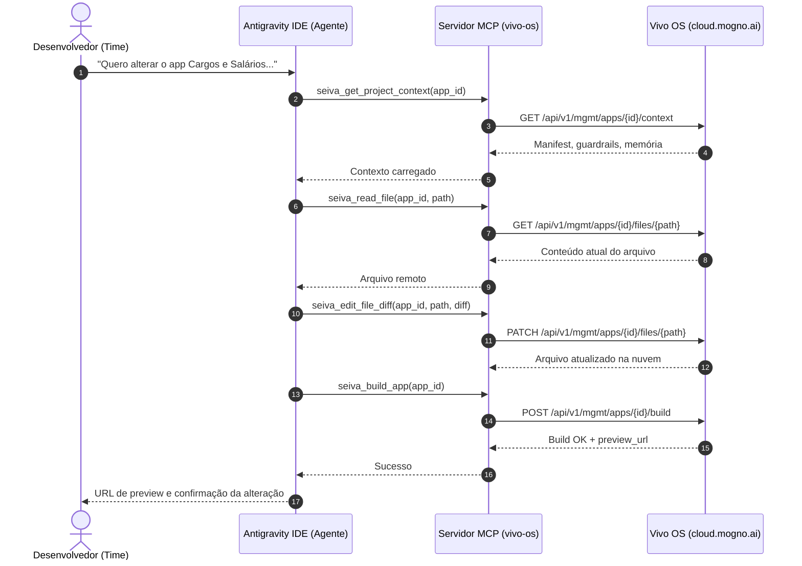

# Vivo OS (Mogno AI) + Antigravity IDE

Ambiente de integração e cockpit operacional para gerenciamento, inspeção e **edição direta na nuvem** de aplicações da plataforma **Vivo OS** (Mogno AI) utilizando o **Google Antigravity IDE**.

> 💡 **Modelo de Operação 100% Remoto:**  
> Não é necessário clonar os códigos-fonte dos apps para sua máquina local. Todas as alterações, leituras, compilações e publicações são executadas **diretamente na plataforma em tempo real** através do servidor MCP (`mogno-mcp`), mantendo os arquivos e o estado sempre centralizados na nuvem.

---

## 🚀 Pré-requisitos

- [Node.js](https://nodejs.org/) (versão 18, 20 ou superior)
- [Antigravity IDE](https://antigravity.google/)
- Chave de API pessoal gerada na plataforma:  
  👉 **https://cloud.mogno.ai/api-keys**

---

## 📦 Como Iniciar (Quickstart para o Time)

### 1. Clonar este repositório de ferramentas
```bash
git clone https://github.com/NicollasAvila/vivo-os-antigravity.git
cd vivo-os-antigravity
```

### 2. Instalar dependências
```bash
npm install
```

### 3. Executar o assistente de configuração
```bash
npm run setup
```
> O assistente validará sua chave individual, criará seu `.env` local (ignorado pelo Git), salvará em `~/.seiva/config.json` e registrará o servidor MCP no seu Antigravity IDE (`~/.gemini/config/mcp_config.json`).

### 4. Validar conexão
```bash
npm run status
```

---

## 🤖 Como Funciona a Edição Direta no Antigravity

Ao conversar com o agente no Antigravity, ele interage diretamente com a plataforma através das ferramentas MCP:



### Ferramentas MCP Nativas Disponíveis ao Agente

| Ferramenta | Descrição |
| :--- | :--- |
| `seiva_get_project_context` | Inspeciona contexto, estrutura e manifest do app remoto |
| `seiva_list_files` | Lista todos os arquivos do app diretamente na nuvem |
| `seiva_read_file` | Lê o conteúdo de qualquer arquivo remoto do app |
| `seiva_edit_file_diff` | Aplica edições cirúrgicas (diffs) diretamente no código remoto |
| `seiva_write_file` | Cria ou sobrescreve arquivos na nuvem |
| `seiva_build_app` | Dispara compilação no sandbox da plataforma e gera preview |
| `seiva_test_app` | Executa smoke tests e loop de auto-correção de erros |
| `seiva_publish_app` | Gera snapshot e publica a versão em produção |
| `seiva_app_lock` | Bloqueia edição concorrente em sessões multi-usuário |
| `seiva_get_app_runtime_errors` | Coleta erros capturados em tempo de execução |

---

## 📋 Apps do Workspace (Exemplos)

Para orientar o agente sobre em qual app trabalhar, basta informar o nome ou o ID:

- **[ PX ] Cargos e Salários:** `a3814723-98d0-40b6-89b4-f85559116cef`
- **Nova Venda - Retrofit:** `0d732fb4-88dd-40b4-909d-a812325c07d3`
- **[ED] Painel de tarefas:** `7aefbfcd-412a-4f01-8871-e2ff6c1ee152`
- **Dashboard T&D:** `fa650b27-59d3-4479-bf9c-dcf4efcadd50`
- **IPNET LAB:** `b84b9557-016a-4487-bf49-9769cdc1d1e2`

Para listar todos os apps disponíveis no workspace:
```bash
npm run status
```

---

## 🔒 Segurança

- Cada desenvolvedor utiliza sua **própria chave de API**.
- O arquivo `.env` é estritamente ignorado no `.gitignore`.
- Nenhuma chave ou segredo fica armazenado no repositório.
